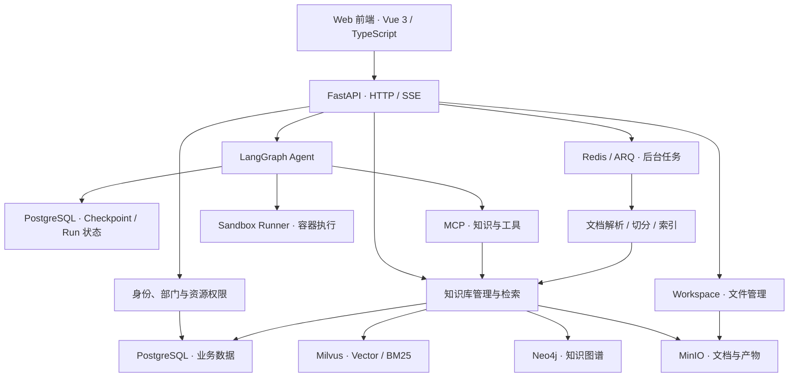

# RAG 智能知识库与 AI Agent 服务平台

[English](README.en.md) · [快速开始](docs/intro/quick-start.md) · [部署指南](docs/advanced/deployment.md)

RAG 是一个基于 **FastAPI、LangGraph、MCP 和 Milvus** 构建的可独立部署的智能知识库与 AI Agent 应用平台，面向企业文档管理、知识检索、来源可追溯问答和多步骤智能任务处理。

项目将**文档解析与索引、混合检索、知识图谱、Agent 工具调用、权限管理及执行状态持久化**整合到同一 Web 应用中。用户可以上传文档构建私有知识库，通过自然语言检索、追问并核对原文来源；Agent 可按授权访问知识库、调用工具，并在 Workspace 中管理任务文件。

> **项目定位：** 支持本地 Docker Compose 部署的应用级 RAG/Agent 系统，不只是检索问答 Demo。模型与可选云端 OCR 服务仍需相应供应商连接和凭据。

## 核心功能

### 1. 多格式文档处理与知识库管理

- **文档导入：** 支持 Markdown、TXT、PDF、Office 文档、表格及图片等已适配格式；可从本地上传、URL 获取或 Workspace 导入文件。
- **可配置解析：** 集成 Docling、MinerU 官方 API、RapidOCR 等解析能力；针对不同文件类型选择适配引擎，处理正文以及关联图片、表格等内容。复杂 PDF 默认依赖配置的 MinerU 官方 API。
- **分块与索引：** 支持文档切分策略和参数配置；文本分块写入检索索引，原始文件及解析资源由对象存储管理。
- **异步任务：** 文档登记、解析、分块与索引使用后台任务队列；支持查看任务状态、失败信息，以及重试、取消、重解析和重索引等操作。
- **数据一致性：** 通过文件 generation、任务归属和投影更新机制，避免尚未完成的新索引直接替换已有可用索引。

### 2. 混合检索、重排序与知识图谱增强

- **向量检索：** 基于 Milvus 和 Embedding 模型进行语义相似度召回。
- **关键词与混合检索：** 支持 Milvus BM25 全文检索，以及向量与 BM25 加权融合；可配置召回数量、权重等查询参数。
- **重排序：** 可选 Rerank 模型对候选片段重新打分与排序。
- **图谱增强：** 使用 LLM 抽取实体和关系，结合 Neo4j 存储图数据；支持图谱浏览、子图查询和基于图关系的辅助召回，并与文本结果融合。
- **来源追溯：** 返回知识库、文档、片段与来源信息，便于打开原文核对答案，而非仅依赖模型生成内容。

### 3. LangGraph Agent 与 MCP 工具调用

- **Agent 执行：** 基于 LangGraph 组织消息、模型调用、工具执行及多轮交互，支持会话与任务轮次管理。
- **知识库 MCP：** 将知识库列表、检索与原文读取封装为 MCP 工具，让 Agent 在权限允许的范围内主动查询知识。
- **可扩展能力：** 提供 MCP 服务配置与工具注册、内置工具及 Skill 资源机制，方便组合不同任务能力。
- **实时反馈：** 通过 SSE 流式返回运行事件、模型输出及工具调用过程，并持久化会话、Turn、Run、消息和执行记录。
- **中断与恢复：** 使用 PostgreSQL 持久化 LangGraph Checkpoint，结合执行状态、队列调度和人工工具审批机制，支持有状态的中断、恢复与执行追踪；实际可恢复范围依具体任务状态和工具副作用而定。

### 4. 多用户、多部门与访问权限

- **身份管理：** 支持首次初始化管理员、用户管理和登录；提供普通用户、管理员、超级管理员角色，并包含可配置的 OIDC 认证接入。
- **部门管理：** 支持部门创建、编辑、删除和用户所属部门管理。
- **资源级授权：** 对知识库等资源区分读取与管理权限，支持全局、指定部门或指定用户的访问范围。
- **执行期权限检查：** 知识检索、文档读取及相关 Agent 工具调用按当前身份验证权限，降低跨用户或跨部门读取不应公开资源的风险。

### 5. Workspace 文件管理与容器沙盒

- **Workspace：** 管理 Agent 工作文件和项目文件，提供目录浏览、搜索、上传、编辑、预览、下载等接口，并可将工作区文件导入知识库。
- **Sandbox：** 通过独立容器执行环境承载受控任务中的代码和文件操作，支持执行产物留存与回读。
- **职责分离：** Workspace 用于组织可访问的文件与任务资料；Sandbox 用于隔离执行环境。二者通过受限的工作目录及授权关系协同，而不是将宿主文件系统无条件暴露给 Agent。

> **安全边界：** 当前沙盒面向**单租户、可信代码**执行场景，不应将其视为已通过多租户不可信代码执行的完整安全隔离认证。公网部署需另外配置访问控制、TLS、网络限制和资源配额。

### 6. 模型配置、知识评测与运行可观测性

- **模型管理：** 配置并测试 Chat、Embedding、Rerank 等模型供应商连接，支持不同任务使用相应模型能力。
- **知识库评测：** 支持 JSONL 基准数据集导入、题目生成、评测执行、结果查询与导出；结合 Recall/F1 和 LLM Judge 等指标分析检索与回答质量。
- **运行记录：** 提供 Agent 消息、调用事件、反馈及执行状态记录，便于排查问题和追踪任务结果。
- **观测集成：** 支持可选 Langfuse 接入；也可通过系统 Dashboard 和持久化记录查看相应使用与运行信息。

## 技术架构



*示意图展示主要组件及逻辑关系，部分服务的实际连接方式以 Docker Compose 和源码为准。*

### 技术栈

| 层次 | 主要技术 | 用途 |
| --- | --- | --- |
| 前端 | Vue 3、TypeScript、Vite、Pinia、Ant Design Vue | 用户界面、知识库管理、对话及任务交互 |
| Web/API | Python、FastAPI、Pydantic、Uvicorn | 业务接口、身份认证、SSE 流式事件 |
| Agent | LangChain、LangGraph、MCP | Agent 编排、工具调用、状态管理与人工审批 |
| 任务调度 | Redis、ARQ | 文档处理和后台任务 |
| 业务与状态存储 | PostgreSQL、SQLAlchemy、LangGraph Postgres Checkpointer | 用户/资源数据、执行记录和 Checkpoint |
| 检索与图谱 | Milvus、BM25、Rerank、Neo4j | 语义检索、混合召回和图谱增强 |
| 文档处理与存储 | Docling、MinerU、RapidOCR、MinIO | 文档解析、OCR 和对象存储 |
| 部署与运行 | Docker Compose、Nginx、Docker Sandbox Runner | 多服务部署、静态资源与反向代理、隔离执行 |
| 可观测与评测 | Dashboard、Langfuse（可选）、知识评测模块 | 运行记录、链路观测和检索/回答质量评估 |

## 项目结构

```text
.
├── backend/
│   ├── rag/
│   │   ├── api/              # HTTP API、认证及业务路由
│   │   ├── modules/          # Agent、知识库、用户权限、Workspace 等
│   │   ├── infrastructure/   # PostgreSQL、MinIO、Neo4j、文档解析等适配
│   │   ├── workers/          # 后台任务 Worker
│   │   └── sandbox_runner/   # 沙盒执行服务
│   ├── pyproject.toml
│   └── uv.lock
├── frontend/                 # Vue 3 前端应用
├── docker/                   # Dockerfile、Nginx 和初始化配置
├── docs/
│   ├── intro/                # 入门与功能操作指南
│   └── advanced/             # 部署、文档解析和可选集成
├── scripts/                  # 首次部署初始化脚本
├── docker-compose.yml        # 默认开发/自托管部署
├── docker-compose.prod.yml   # 生产部署
└── docker-compose.no-knowledge.yml
```

## 典型使用流程

1. **部署并配置：** 初始化环境，启动服务，创建管理员并配置模型供应商。
2. **创建知识库：** 上传文档，等待后台解析、分块、向量索引与可选图谱构建完成。
3. **检索与问答：** 配置向量、BM25、混合检索及可选重排序，使用对话或 Agent 提问并查看引用来源。
4. **组织团队协作：** 创建用户和部门，为知识资源设置读取和管理权限。
5. **执行任务与验收：** 根据需要使用 MCP 工具、Workspace、Sandbox 和评测功能，并通过运行记录检查结果。

## 安装与启动

### 环境要求

- Docker Engine、Docker Compose v2，以及可用的容器执行环境。
- 初始化脚本需要 **Python 3.10+**；如果**不使用 Docker、直接运行后端源码**，需使用 **Python >=3.12 且 <3.14**（项目配置为 Python 3.13）。
- 首次构建和依赖安装需要网络连接；在线模型及云端 OCR 需要对应供应商凭据。
- 确保有足够的磁盘与内存资源，并确认默认服务端口没有被占用。

### 1. 初始化环境

在仓库根目录执行：

```bash
bash scripts/init.sh
```

脚本会生成本地私有配置。检查生成的 `.env`，按需填写模型服务凭据，例如：

```dotenv
DEEPSEEK_API_KEY=<供应商密钥>
SILICONFLOW_API_KEY=<Embedding 与 Rerank 供应商密钥>
RAG_MINERU_API_KEY=<可选，复杂 PDF 使用的 MinerU 密钥>
```

这些只是占位符，不是可用密钥。也可以在部署后通过系统设置管理适用的模型连接。

### 2. 启动服务

```bash
docker compose up -d --build
docker compose ps
curl --fail http://localhost:25050/api/system/ready
```

默认入口：

| 服务 | 地址 |
| --- | --- |
| Web 管理与对话界面 | `http://localhost:25173` |
| 后端 API | `http://localhost:25050` |
| 服务就绪检查 | `http://localhost:25050/api/system/ready` |

首次打开前端时创建管理员账号，随后在设置中检查模型连接，创建知识库并上传文档。**上传成功不等于索引完成**，需要等待文件显示已索引状态后再查询。

默认示例模型配置包括：

- Chat：`deepseek:deepseek-flash`
- Embedding：`siliconflow-cn:Pro/BAAI/bge-m3`
- Rerank：`siliconflow-cn:Pro/BAAI/bge-reranker-v2-m3`

模型可用性取决于实际账号、服务商及配置。就绪检查仅代表服务满足相应接流量条件，不能代替文档解析、检索或问答的业务验收。

### 3. 生产部署与配置

生产部署需要独立的 `.env.prod`、专用的服务与数据目录，并预先构建沙盒镜像、固定镜像标识。具体操作、端口映射、配置更新、备份及关闭本地知识库的组合部署参见 [部署指南](docs/advanced/deployment.md)。

**安全提醒：** 不要将 `.env`、`.env.prod`、API Key、管理员密码或运行数据提交到公开仓库。公开部署应自行配置 HTTPS、网络边界、访问策略及数据备份。

## 操作指南

- [首次部署和基础使用](docs/intro/quick-start.md)
- [知识库、文档生命周期及图谱](docs/intro/knowledge-base.md)
- [模型配置](docs/intro/model-config.md)
- [知识库评测](docs/intro/evaluation.md)
- [文档解析与 OCR](docs/advanced/document-processing.md)
- [生产部署、配置和备份](docs/advanced/deployment.md)
- [可选 Langfuse 集成](docs/advanced/langfuse-integration.md)

## 使用限制

本项目提供一套可自托管的 RAG/Agent 应用实现，但不同部署环境的模型质量、OCR 能力、资源消耗和性能取决于实际配置。README 不承诺未经验证的检索准确率、并发吞吐量或故障恢复指标。

Sandbox 当前针对单租户可信代码运行，不应直接用作面向任意不可信用户的多租户在线执行服务。生产上线前应单独验证权限策略、外部工具、文件访问、日志脱敏及数据备份恢复。

## 许可证与来源

本项目采用 [MIT 许可证](LICENSE)。上游来源、版权信息及第三方素材声明见 [UPSTREAM.md](UPSTREAM.md)。
